# FOMHD branch history

This graph shows actual commit ancestry and every fetched branch head.
It includes up to 120 recent commits plus older branch heads; omitted ancestry is marked.
The graph is a generated snapshot, preceding its own rendering commit.
Main-branch pushes refresh it automatically; other branch updates are also polled hourly.
For the live GitHub interface, use [Network](https://github.com/ziyu59151/fomhd/network)
(private-repository plan restrictions may apply).

```mermaid
flowchart LR
  cf25329978364763a695bd185e986a6c0255f5df6["f2532997 · Establish C++/CUDA project conventions and auxiliary environment"]
  click cf25329978364763a695bd185e986a6c0255f5df6 "https://github.com/ziyu59151/fomhd/commit/f25329978364763a695bd185e986a6c0255f5df6"
  c48beca72d3b7260673d6a6823cbbd2b7fcb90581["48beca72 · Preserve verified A0 native reference and implementation pseudocode"]
  cf25329978364763a695bd185e986a6c0255f5df6 --> c48beca72d3b7260673d6a6823cbbd2b7fcb90581
  click c48beca72d3b7260673d6a6823cbbd2b7fcb90581 "https://github.com/ziyu59151/fomhd/commit/48beca72d3b7260673d6a6823cbbd2b7fcb90581"
  c1840cfa60e3b29401c9ea55a4ee8876351f582c1["1840cfa6 · Preserve independent native oracle exporter on reference branch"]
  c48beca72d3b7260673d6a6823cbbd2b7fcb90581 --> c1840cfa60e3b29401c9ea55a4ee8876351f582c1
  click c1840cfa60e3b29401c9ea55a4ee8876351f582c1 "https://github.com/ziyu59151/fomhd/commit/1840cfa60e3b29401c9ea55a4ee8876351f582c1"
  cd9390ac65657974a1cbf7819b9c79b35e2cecd03["d9390ac6 · Implement Warp A0 and switchable quasineutral electrons"]
  c48beca72d3b7260673d6a6823cbbd2b7fcb90581 --> cd9390ac65657974a1cbf7819b9c79b35e2cecd03
  click cd9390ac65657974a1cbf7819b9c79b35e2cecd03 "https://github.com/ziyu59151/fomhd/commit/d9390ac65657974a1cbf7819b9c79b35e2cecd03"
  c0f094115c385781c0356b333dc545539c2ed43d8["0f094115 · docs: record completed A0 scans and clarify frequency scope"]
  cd9390ac65657974a1cbf7819b9c79b35e2cecd03 --> c0f094115c385781c0356b333dc545539c2ed43d8
  click c0f094115c385781c0356b333dc545539c2ed43d8 "https://github.com/ziyu59151/fomhd/commit/0f094115c385781c0356b333dc545539c2ed43d8"
  cf514d38fd4f51a92ca93f68035896675b11dffe1["f514d38f · docs: clarify A0 diagnostics and runtime responsibilities"]
  c0f094115c385781c0356b333dc545539c2ed43d8 --> cf514d38fd4f51a92ca93f68035896675b11dffe1
  click cf514d38fd4f51a92ca93f68035896675b11dffe1 "https://github.com/ziyu59151/fomhd/commit/f514d38fd4f51a92ca93f68035896675b11dffe1"
  cb2dc5797fbe11ef32bb0e42d1b52a411591370e8["b2dc5797 · Make Python Warp the RK4 mainline and add fixed-domain verification"]
  cf514d38fd4f51a92ca93f68035896675b11dffe1 --> cb2dc5797fbe11ef32bb0e42d1b52a411591370e8
  click cb2dc5797fbe11ef32bb0e42d1b52a411591370e8 "https://github.com/ziyu59151/fomhd/commit/b2dc5797fbe11ef32bb0e42d1b52a411591370e8"
  c92c1d3e461424018ac85b1bc71deb5904caf838e["92c1d3e4 · docs: update branch graph [skip ci]"]
  cb2dc5797fbe11ef32bb0e42d1b52a411591370e8 --> c92c1d3e461424018ac85b1bc71deb5904caf838e
  click c92c1d3e461424018ac85b1bc71deb5904caf838e "https://github.com/ziyu59151/fomhd/commit/92c1d3e461424018ac85b1bc71deb5904caf838e"
  caa06cf91b5a0255c31345989f660299822eec8ef["aa06cf91 · docs: update branch graph [skip ci]"]
  c92c1d3e461424018ac85b1bc71deb5904caf838e --> caa06cf91b5a0255c31345989f660299822eec8ef
  click caa06cf91b5a0255c31345989f660299822eec8ef "https://github.com/ziyu59151/fomhd/commit/aa06cf91b5a0255c31345989f660299822eec8ef"
  c267d8e11d0f359bb7032c0500613c7f608bceda8["267d8e11 · docs: update branch graph [skip ci]"]
  caa06cf91b5a0255c31345989f660299822eec8ef --> c267d8e11d0f359bb7032c0500613c7f608bceda8
  click c267d8e11d0f359bb7032c0500613c7f608bceda8 "https://github.com/ziyu59151/fomhd/commit/267d8e11d0f359bb7032c0500613c7f608bceda8"
  cc55f1b6485873868527874e36e8d84e166756275["c55f1b64 · Refine the forward wall trace without relaxing physical constraints"]
  c267d8e11d0f359bb7032c0500613c7f608bceda8 --> cc55f1b6485873868527874e36e8d84e166756275
  click cc55f1b6485873868527874e36e8d84e166756275 "https://github.com/ziyu59151/fomhd/commit/c55f1b6485873868527874e36e8d84e166756275"
  cbf9c06576d0e36b6b6e3cf64d2d5571aeb3b88fd["bf9c0657 · docs: update branch graph [skip ci]"]
  cc55f1b6485873868527874e36e8d84e166756275 --> cbf9c06576d0e36b6b6e3cf64d2d5571aeb3b88fd
  click cbf9c06576d0e36b6b6e3cf64d2d5571aeb3b88fd "https://github.com/ziyu59151/fomhd/commit/bf9c06576d0e36b6b6e3cf64d2d5571aeb3b88fd"
  c69efcac0dbf83fc8fe8092ec878e88656ef13ff7["69efcac0 · Record fixed-domain spatial controls and eight-cycle mode evidence"]
  cbf9c06576d0e36b6b6e3cf64d2d5571aeb3b88fd --> c69efcac0dbf83fc8fe8092ec878e88656ef13ff7
  click c69efcac0dbf83fc8fe8092ec878e88656ef13ff7 "https://github.com/ziyu59151/fomhd/commit/69efcac0dbf83fc8fe8092ec878e88656ef13ff7"
  cad7173810ff59367d1bab807269b6866835b3e69["ad717381 · docs: update branch graph [skip ci]"]
  c69efcac0dbf83fc8fe8092ec878e88656ef13ff7 --> cad7173810ff59367d1bab807269b6866835b3e69
  click cad7173810ff59367d1bab807269b6866835b3e69 "https://github.com/ziyu59151/fomhd/commit/ad7173810ff59367d1bab807269b6866835b3e69"
  c242f721c3d08cad3ebe28339ceced1ddeae177ca["242f721c · docs: update branch graph [skip ci]"]
  cad7173810ff59367d1bab807269b6866835b3e69 --> c242f721c3d08cad3ebe28339ceced1ddeae177ca
  click c242f721c3d08cad3ebe28339ceced1ddeae177ca "https://github.com/ziyu59151/fomhd/commit/242f721c3d08cad3ebe28339ceced1ddeae177ca"
  ccba996c68f8c92f607d4a1da6acd3e2ee383785c["cba996c6 · docs: update branch graph [skip ci]"]
  c242f721c3d08cad3ebe28339ceced1ddeae177ca --> ccba996c68f8c92f607d4a1da6acd3e2ee383785c
  click ccba996c68f8c92f607d4a1da6acd3e2ee383785c "https://github.com/ziyu59151/fomhd/commit/cba996c68f8c92f607d4a1da6acd3e2ee383785c"
  cf487d8c5fecb54fc26dfe5600a72cf0b1933b844["f487d8c5 · feat: establish massless A0 global fast-mode prototype"]
  cad7173810ff59367d1bab807269b6866835b3e69 --> cf487d8c5fecb54fc26dfe5600a72cf0b1933b844
  click cf487d8c5fecb54fc26dfe5600a72cf0b1933b844 "https://github.com/ziyu59151/fomhd/commit/f487d8c5fecb54fc26dfe5600a72cf0b1933b844"
  cb227f253d80227fa25e137486391f9afdea90d68["b227f253 · Merge reviewed massless A0 global fast-branch prototype"]
  ccba996c68f8c92f607d4a1da6acd3e2ee383785c --> cb227f253d80227fa25e137486391f9afdea90d68
  cf487d8c5fecb54fc26dfe5600a72cf0b1933b844 --> cb227f253d80227fa25e137486391f9afdea90d68
  click cb227f253d80227fa25e137486391f9afdea90d68 "https://github.com/ziyu59151/fomhd/commit/b227f253d80227fa25e137486391f9afdea90d68"
  ce18b9517faa51a63f4a0e34dcf79019c29c806b7["e18b9517 · docs: update branch graph [skip ci]"]
  cb227f253d80227fa25e137486391f9afdea90d68 --> ce18b9517faa51a63f4a0e34dcf79019c29c806b7
  click ce18b9517faa51a63f4a0e34dcf79019c29c806b7 "https://github.com/ziyu59151/fomhd/commit/e18b9517faa51a63f4a0e34dcf79019c29c806b7"
  ca3559899f2addd43aa889d1e5b4f6faef16eff67["a3559899 · docs: update branch graph [skip ci]"]
  ce18b9517faa51a63f4a0e34dcf79019c29c806b7 --> ca3559899f2addd43aa889d1e5b4f6faef16eff67
  click ca3559899f2addd43aa889d1e5b4f6faef16eff67 "https://github.com/ziyu59151/fomhd/commit/a3559899f2addd43aa889d1e5b4f6faef16eff67"
  ca57daedf5ce36aafd44e9639826c519d6cd024d8["a57daedf · docs: update branch graph [skip ci]"]
  ca3559899f2addd43aa889d1e5b4f6faef16eff67 --> ca57daedf5ce36aafd44e9639826c519d6cd024d8
  click ca57daedf5ce36aafd44e9639826c519d6cd024d8 "https://github.com/ziyu59151/fomhd/commit/a57daedf5ce36aafd44e9639826c519d6cd024d8"
  c0bd141fa5945806497f6a17e908fe921ed692672["0bd141fa · docs: update branch graph [skip ci]"]
  ca57daedf5ce36aafd44e9639826c519d6cd024d8 --> c0bd141fa5945806497f6a17e908fe921ed692672
  click c0bd141fa5945806497f6a17e908fe921ed692672 "https://github.com/ziyu59151/fomhd/commit/0bd141fa5945806497f6a17e908fe921ed692672"
  cbf037af95705b42bfea4d31639f1bd847b9a10c4["bf037af9 · docs: update branch graph [skip ci]"]
  c0bd141fa5945806497f6a17e908fe921ed692672 --> cbf037af95705b42bfea4d31639f1bd847b9a10c4
  click cbf037af95705b42bfea4d31639f1bd847b9a10c4 "https://github.com/ziyu59151/fomhd/commit/bf037af95705b42bfea4d31639f1bd847b9a10c4"
  cbb347d39df387a1101f2f21a23a3ff58f4d983a9["bb347d39 · Add bounded spatial refinement and explicit mode structure analysis"]
  ca3559899f2addd43aa889d1e5b4f6faef16eff67 --> cbb347d39df387a1101f2f21a23a3ff58f4d983a9
  click cbb347d39df387a1101f2f21a23a3ff58f4d983a9 "https://github.com/ziyu59151/fomhd/commit/bb347d39df387a1101f2f21a23a3ff58f4d983a9"
  c9fb4dc41bddc42ff9d885fa5ea2fd0d3ad24df2c["9fb4dc41 · Make mode structure comparisons independent of eigenvector scale and phase"]
  cbb347d39df387a1101f2f21a23a3ff58f4d983a9 --> c9fb4dc41bddc42ff9d885fa5ea2fd0d3ad24df2c
  click c9fb4dc41bddc42ff9d885fa5ea2fd0d3ad24df2c "https://github.com/ziyu59151/fomhd/commit/9fb4dc41bddc42ff9d885fa5ea2fd0d3ad24df2c"
  c81e89dbb9f58e36ff73be89e2e1912e7354920c4["81e89dbb · Record interim grid spectra and unresolved EAST branch continuity"]
  c9fb4dc41bddc42ff9d885fa5ea2fd0d3ad24df2c --> c81e89dbb9f58e36ff73be89e2e1912e7354920c4
  click c81e89dbb9f58e36ff73be89e2e1912e7354920c4 "https://github.com/ziyu59151/fomhd/commit/81e89dbb9f58e36ff73be89e2e1912e7354920c4"
  c25d316c43a73844fddd768764cf6bf09ce416232["25d316c4 · Merge reviewed grid refinement tools and interim evidence"]
  cbf037af95705b42bfea4d31639f1bd847b9a10c4 --> c25d316c43a73844fddd768764cf6bf09ce416232
  c81e89dbb9f58e36ff73be89e2e1912e7354920c4 --> c25d316c43a73844fddd768764cf6bf09ce416232
  click c25d316c43a73844fddd768764cf6bf09ce416232 "https://github.com/ziyu59151/fomhd/commit/25d316c43a73844fddd768764cf6bf09ce416232"
  c52fedecc471f0a681020f3894623924da6029fa3["52fedecc · docs: update branch graph [skip ci]"]
  cbf037af95705b42bfea4d31639f1bd847b9a10c4 --> c52fedecc471f0a681020f3894623924da6029fa3
  click c52fedecc471f0a681020f3894623924da6029fa3 "https://github.com/ziyu59151/fomhd/commit/52fedecc471f0a681020f3894623924da6029fa3"
  c7a390027dc80b52ed2f268d5ccf76d06f4f82f3b["7a390027 · Preserve branch graph updates alongside reviewed grid refinement"]
  c25d316c43a73844fddd768764cf6bf09ce416232 --> c7a390027dc80b52ed2f268d5ccf76d06f4f82f3b
  c52fedecc471f0a681020f3894623924da6029fa3 --> c7a390027dc80b52ed2f268d5ccf76d06f4f82f3b
  click c7a390027dc80b52ed2f268d5ccf76d06f4f82f3b "https://github.com/ziyu59151/fomhd/commit/7a390027dc80b52ed2f268d5ccf76d06f4f82f3b"
  c5494eb299e2f2b1c66c88eaf38932dbcaff8bc7e["5494eb29 · docs: update branch graph [skip ci]"]
  c7a390027dc80b52ed2f268d5ccf76d06f4f82f3b --> c5494eb299e2f2b1c66c88eaf38932dbcaff8bc7e
  click c5494eb299e2f2b1c66c88eaf38932dbcaff8bc7e "https://github.com/ziyu59151/fomhd/commit/5494eb299e2f2b1c66c88eaf38932dbcaff8bc7e"
  cb49157977ffd8a3b6c69ad665d826ec07f34017f["b4915797 · docs: update branch graph [skip ci]"]
  c5494eb299e2f2b1c66c88eaf38932dbcaff8bc7e --> cb49157977ffd8a3b6c69ad665d826ec07f34017f
  click cb49157977ffd8a3b6c69ad665d826ec07f34017f "https://github.com/ziyu59151/fomhd/commit/b49157977ffd8a3b6c69ad665d826ec07f34017f"
  cb74e85782de736522730d95b2f329be40134fe7a["b74e8578 · Clarify A0 benchmark evidence and record prototype development priorities"]
  c7a390027dc80b52ed2f268d5ccf76d06f4f82f3b --> cb74e85782de736522730d95b2f329be40134fe7a
  click cb74e85782de736522730d95b2f329be40134fe7a "https://github.com/ziyu59151/fomhd/commit/b74e85782de736522730d95b2f329be40134fe7a"
  ca918284c702800c14ee25b73b95fd5b028de6720["a918284c · Merge A0 benchmark presentation and prototype workflow"]
  cb49157977ffd8a3b6c69ad665d826ec07f34017f --> ca918284c702800c14ee25b73b95fd5b028de6720
  cb74e85782de736522730d95b2f329be40134fe7a --> ca918284c702800c14ee25b73b95fd5b028de6720
  click ca918284c702800c14ee25b73b95fd5b028de6720 "https://github.com/ziyu59151/fomhd/commit/a918284c702800c14ee25b73b95fd5b028de6720"
  c0faa08f41f17ce3f09beb5a47a22c689ec1a2b52["0faa08f4 · docs: update branch graph [skip ci]"]
  cb49157977ffd8a3b6c69ad665d826ec07f34017f --> c0faa08f41f17ce3f09beb5a47a22c689ec1a2b52
  click c0faa08f41f17ce3f09beb5a47a22c689ec1a2b52 "https://github.com/ziyu59151/fomhd/commit/0faa08f41f17ce3f09beb5a47a22c689ec1a2b52"
  cb62683e21b8f33e47dc0ab40c938cfab29928228["b62683e2 · Merge latest generated branch graph"]
  ca918284c702800c14ee25b73b95fd5b028de6720 --> cb62683e21b8f33e47dc0ab40c938cfab29928228
  c0faa08f41f17ce3f09beb5a47a22c689ec1a2b52 --> cb62683e21b8f33e47dc0ab40c938cfab29928228
  click cb62683e21b8f33e47dc0ab40c938cfab29928228 "https://github.com/ziyu59151/fomhd/commit/b62683e21b8f33e47dc0ab40c938cfab29928228"
  c3d2fe01cc315950ff85ac56623fa81905604a894["3d2fe01c · docs: update branch graph [skip ci]"]
  cb62683e21b8f33e47dc0ab40c938cfab29928228 --> c3d2fe01cc315950ff85ac56623fa81905604a894
  click c3d2fe01cc315950ff85ac56623fa81905604a894 "https://github.com/ziyu59151/fomhd/commit/3d2fe01cc315950ff85ac56623fa81905604a894"
  c0ff316a7ac35d7508b426fac3b268d99713dd1cb["0ff316a7 · Render nonlinear mode maps with contiguous cells and compact vectors"]
  c3d2fe01cc315950ff85ac56623fa81905604a894 --> c0ff316a7ac35d7508b426fac3b268d99713dd1cb
  click c0ff316a7ac35d7508b426fac3b268d99713dd1cb "https://github.com/ziyu59151/fomhd/commit/0ff316a7ac35d7508b426fac3b268d99713dd1cb"
  b0(["codex/a0-benchmark-gallery"]) -.-> c0f094115c385781c0356b333dc545539c2ed43d8
  b1(["codex/a0-grid-convergence"]) -.-> c81e89dbb9f58e36ff73be89e2e1912e7354920c4
  b2(["codex/a0-nl-cellplots"]) -.-> c0ff316a7ac35d7508b426fac3b268d99713dd1cb
  b3(["codex/a0-report-closeout"]) -.-> cb74e85782de736522730d95b2f329be40134fe7a
  b4(["codex/a0-runtime-guidance"]) -.-> cf514d38fd4f51a92ca93f68035896675b11dffe1
  b5(["codex/a0-tokamak-cae"]) -.-> cf487d8c5fecb54fc26dfe5600a72cf0b1933b844
  b6(["codex/a0-warp"]) -.-> cb2dc5797fbe11ef32bb0e42d1b52a411591370e8
  b7(["main"]) -.-> c3d2fe01cc315950ff85ac56623fa81905604a894
  b8(["reference/a0-native"]) -.-> c1840cfa60e3b29401c9ea55a4ee8876351f582c1
  b9(["release/a0"]) -.-> cb227f253d80227fa25e137486391f9afdea90d68
```

<!-- branch-graph-refs: {"codex/a0-benchmark-gallery": "0f094115c385781c0356b333dc545539c2ed43d8", "codex/a0-grid-convergence": "81e89dbb9f58e36ff73be89e2e1912e7354920c4", "codex/a0-nl-cellplots": "0ff316a7ac35d7508b426fac3b268d99713dd1cb", "codex/a0-report-closeout": "b74e85782de736522730d95b2f329be40134fe7a", "codex/a0-runtime-guidance": "f514d38fd4f51a92ca93f68035896675b11dffe1", "codex/a0-tokamak-cae": "f487d8c5fecb54fc26dfe5600a72cf0b1933b844", "codex/a0-warp": "b2dc5797fbe11ef32bb0e42d1b52a411591370e8", "main": "3d2fe01cc315950ff85ac56623fa81905604a894", "reference/a0-native": "1840cfa60e3b29401c9ea55a4ee8876351f582c1", "release/a0": "b227f253d80227fa25e137486391f9afdea90d68"} -->



Regenerate after fetching:

```bash
git fetch origin --prune
python3 tools/branch_graph.py --output docs/BRANCH_GRAPH.md
```

Local terminal graph: `git graph` (see [development policy](development.md)).
