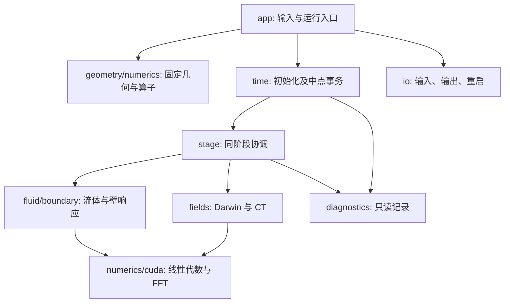

# A0 实现级伪代码与维护说明书

> Status: active implementation specification. Warp/CuPy is the D060 development implementation; the native C++/CUDA reference is preserved. Acceptance evidence is recorded separately in [the migration record](../WARP_IMPLEMENTATION.md) and [native V&V](../A0_VERIFICATION.md).
> 依赖：[开发约定](../development.md)、[A0 主规格](../../../../fomhd-design/mainline_design/implementation/A0/A0_IMPLEMENTATION_SPEC.md)、[全域离散](../../../../fomhd-design/mainline_design/implementation/A0/A0_GLOBAL_DISCRETIZATION.md)及其 GC1–GC16。
> 权威：设计库拥有数学模型；本目录拥有该模型到 Warp/CuPy 与固定 C++/CUDA 参考的逐步实现映射。项目工程选择不是文献原算法或稳定性证明。
> 同步触发：对应源码、接口、文件格式、库绑定或数学合同改变；伪代码、实现、测试须同版本维护。
> 最近同步：2026-11-05。

## 阅读与文件对应

Remove the `docs/pseudocode/` prefix and final `.md` suffix to obtain the implementation path. For example, `fomhd/fields.py.md` maps to `fomhd/fields.py`, and `src/fields/darwin.cpp.md` maps to the native reference. README and routing narratives are navigation documents, not fictitious source modules. The Warp entry point is `fomhd/__main__.py`; native types and entry points remain under `include/` and `app/`. Python steps use the distinct `A0-PY-…` namespace so their IDs cannot collide with native steps.

| Warp responsibility | Mirrored pseudocode |
|---|---|
| CLI, strict configuration, run products and restart | [entry](fomhd/__main__.py.md), [I/O](fomhd/io.py.md) |
| Physical records, layout and state operations | [types](fomhd/types.py.md), [core](fomhd/core.py.md) |
| Device ownership, established FFT/LU/SVD and Warp kernels | [backend](fomhd/backend.py.md) |
| Closed geometry and compatible RZ/Fourier operators | [geometry](fomhd/geometry.py.md), [operators](fomhd/operators.py.md) |
| Fluid equations, wall reactions and finite-mass Darwin fields | [fluid](fomhd/fluid.py.md), [wall](fomhd/wall.py.md), [fields](fomhd/fields.py.md) |
| Stage evaluation, explicit midpoint/RK4 and timestep guards | [stage](fomhd/stage.py.md), [time](fomhd/time.py.md), [stability](fomhd/stability.py.md) |
| Diagnostics and source/interval accounting | [diagnostics](fomhd/diagnostics.py.md) |
| Coupled manufactured solutions and independent spatial checks | [MMS fixture](tests/warp/mms_fixture.py.md), [MMS CLI](tools/warp_mms.py.md) |
| Quasineutral massless equations, constraints and diagnostics | [massless stage](fomhd/massless.py.md), [massless checks](fomhd/massless_checks.py.md) |
| Local Hall response, closed-wall reconstruction and evidence output | [massless fixture](tests/warp/massless_verification_fixture.py.md), [massless verification CLI](tools/warp_massless_verify.py.md), [verification tests](tests/warp/test_massless_verification.py.md) |
| Equal-horizon scans, physical scales and plots | [benchmark](tools/warp_benchmark.py.md), [frequency table](tools/frequency_table.py.md), [plots](tools/plots/plot_warp_benchmarks.py.md) |

The following table describes the fixed native reference.

| 目标与职责 | 伪代码正文 |
|---|---|
| 构建、原生库、选项与实际版本登记 | [CMakeLists.txt](CMakeLists.txt.md) |
| 字段、阶段、源对象、结果/错误 | [types.hpp](include/fomhd/types.hpp.md) |
| 分配、导入、有效域与状态组合 | [state.cpp](src/core/state.cpp.md) |
| 数值域、唯一实体、权与几何距离 | [mesh.cpp](src/geometry/mesh.cpp.md) |
| incidence、共轭复形、I/H 与 B 转移 | [operators.cpp](src/numerics/operators.cpp.md) |
| Fourier、padding、完整采样导数 | [fourier.cpp](src/numerics/fourier.cpp.md) |
| 稠密 LU、SVD、秩选择和内存预算 | [dense.cpp](src/numerics/dense.cpp.md) |
| 两流体原始量、梯度/伴随与全部 RHS | [fluid.cpp](src/fluid/fluid.cpp.md) |
| 壁迹、全 RHS 反力和实际边界账 | [wall.cpp](src/boundary/wall.cpp.md) |
| Poisson、模耦合 Darwin、CT | [darwin.cpp](src/fields/darwin.cpp.md) |
| 同阶段组织与源聚合 | [stage.cpp](src/time/stage.cpp.md) |
| 显式中点、唯一积分账、接受/失败 | [midpoint.cpp](src/time/midpoint.cpp.md) |
| 初始化、阶段、步与快照诊断 | [diagnostics.cpp](src/diagnostics/diagnostics.cpp.md) |
| 配置字段及输入校验 | [config.cpp](src/io/config.cpp.md) |
| NPZ/NPY、字节序和数组 schema | [npz.cpp](src/io/npz.cpp.md) |
| 运行清单、原子写入、restart | [run.cpp](src/io/run.cpp.md) |
| CUDA 生命周期、库调用与必要 kernel | [backend.cu](src/cuda/backend.cu.md) |
| validate/run/inspect 入口 | [fomhd.cpp](app/fomhd.cpp.md) |
| Prescribed-source interface and diagnostic rates | [verification.hpp](include/fomhd/verification.hpp.md), [source.cpp](src/diagnostics/source.cpp.md) |
| Coupled temporal MMS, spatial MMS and transaction controls | [coupled](tests/coupled_verification.cpp.md), [spatial](tests/spatial_verification.cpp.md), [transaction](tests/transaction.cpp.md) |
| Linear refinement and source-accounting regressions | [linear](tests/linear_refinement.cpp.md), [source controls](tests/source_controls.cpp.md) |
| Local continuum response and admissible CGL eigenmodes | [dispersion](tests/dispersion.cpp.md), [periodic adapter](tests/periodic_fixture.hpp.md) |
| 独立测试、负对照、验收顺序 | [test contracts](tests/README.md) |
| 输入生成配方与 benchmark 范围 | [cases](cases/README.md) |
| 收敛/复频率离线分析 | [analyze.py](tools/analyze.py.md) |
| Exploratory benchmark, local-mode and accepted-run figures | [verification plots](tools/plots/plot_verification.py.md), [local modes](tools/plots/plot_local_modes.py.md), [run overview](tools/plots/plot_run.py.md) |
| 单 GPU 作业与运行目录 | [a0.slurm](jobs/a0.slurm.md) |

[TRACEABILITY.tsv](TRACEABILITY.tsv)连接步骤 ID、公式、目标文件和测试 ID；跨模块路由的 `target_path` 用分号列出真实源码文件，测试辅助 fixture 映射到使用它的测试，不把 fixture 本身当成独立通过的测试。[SOURCE_BASELINE.json](SOURCE_BASELINE.json)记录设计来源哈希，并分别保留原生参考与 Warp 的证据范围。这里的设计库链接用于本工作区导航；构建/运行不读取家目录中的设计库。复制仓库后仍可阅读完整伪代码，核对数学来源时按基线记录找相应设计版本。

## 记号与执行约定

- `require(predicate, code, context)` 为假时返回 `Failure`，停止当前调用；`x = TRY F(...)` 原样向上传递失败并增加调用位置。没有隐式重试、裁剪、减步或 CPU 回退。
- 半开循环 `for i in [0,N)`；索引从 0 开始。`adj(A)` 是实际离散矩阵的共轭转置，`A * x` 是矩阵作用，逐点乘写 `hadamard` 或明确逐索引。`solve(A,b)` 只指本目录的带检查 LU 接口，绝不是显式求逆。
- 数组下标之外的 `R`、`C`、`T` 不复用：`cells` 是 C 集合，`curl` 是旋度，`wall_T` 是壁约束。分量固定 `(R,phi,Z)`；张量 `(a,b)` 中 a 是矢量分量、b 是微分方向。
- 所有实际状态使用 FP64/complex128、SI；数学库可使用自己的复数类型，逐元素适配。基线单进程，CUDA 单 stream、单 GPU；无自动微分、LibTorch 运行依赖、MPI、粒子或 WR 实现。
- 任意尺寸加乘先做溢出与内存预算检查；错误包含实体/模式/阶段。隐含的标准叶操作仅限数组分配/遍历、有限值/算术、排序、哈希、标准文件系统与已列明的库 API。
- 几何初始化在 host；固定矩阵保留 host 副本并可上传。CPU/CUDA 调用同一个逻辑接口，矩阵、工作区和状态只有一个拥有者。每一库调用检查立即状态；读取设备结果前同步检查延迟错误。
- 为避免逐行重复，模块成员函数从调用时绑定的只读 context 读取 `operators/config/constants/budgets/runtime`；物种函数在入口绑定 `n,pi,u,m,q` 为其 ctx 的字段短名。翻译成自由函数时必须显式传这些参数，不用可变全局变量。所有阶段相关对象均由 StageResult arena 拥有，长期静态 context 不保存阶段借用。
- 场矩阵组装用任意复单位向量；这种线性试向量**不要求 Hermitian，也不能取 real**。实际物理阶段恢复才要求实场和共轭对称。否则会把复杂 Fourier 线性系统错误地变成非线性或实线性系统。

## 调用和完成边界

A0 全路径覆盖固定封闭阶梯域及其输入、错误和输出。A1 复用空间核心并换时间调度；A2 只增只读粒子消费者；A3 的 FK 生产者还须专项实现，不在本目录伪造完成。周期 Cartesian 盒属于独立测试 fixture，不从 `fixed_lcfs_static` 偷换边界。

伪代码是可执行实现的说明书，不能替代运行证据。原生与 Warp 的构建、输入往返、空间/时间收敛、CPU/GPU 和 restart 结果分别登记在各自 V&V 记录中；未运行项目不因本目录存在而通过。四阶只针对远内域，低阶阶梯壁与显式中点有限观察窗的限制继续有效。
