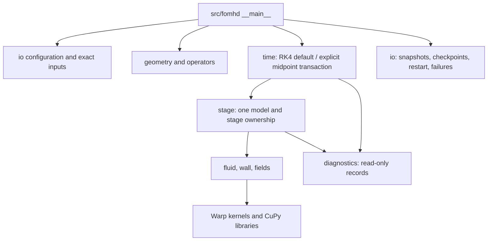

# A1 实现级伪代码与维护说明书

> Status: active Python/Warp implementation specification for `main`.
> `reference/a0-native` owns the frozen native implementation and its mirrored
> pseudocode. Acceptance evidence is recorded separately from implementation
> contracts.
> Authority: the design repository owns the mathematical model; this directory
> owns the step-by-step mapping to the active Python/Warp/CuPy source.
> Last synchronized: 2026-11-08; inherited A0 step IDs remain stable.

## File mapping

Remove `docs/pseudocode/` and the final `.md` suffix to obtain the mirrored
source path. For example, `src/fomhd/fields.py.md` maps to
`src/fomhd/fields.py`, and `tests/warp/test_runtime.py.md` maps to
`tests/warp/test_runtime.py`. README and routing narratives are navigation
documents, not fictitious modules. The active entry point is
`src/fomhd/__main__.py`.

| Mainline responsibility | Mirrored pseudocode |
|---|---|
| Reduced-ion C1/C2 research | [algorithm](src/fomhd/time_multirate.md), [runner](tools/warp_multirate_ion.py.md) |
| Matched lean synchronous cost reference | [cost runner](tools/warp_multirate_cost.py.md), [tests](tests/warp/test_warp_multirate_cost.py.md) |
| A1 T1 complete ion stage-path waveform iteration | [waveform scheduler](src/fomhd/time_waveform.py.md), [tests](tests/warp/test_time_waveform.py.md) |
| A1 T1 controlled comparison and A0-style gallery | [runner](tools/warp_t1_verify.py.md), [gallery](tools/plots/build_a1_t1_report.py.md) |
| A1 T0 fixed-tangent microsteps and fixed wall-system reuse | [predictor](src/fomhd/time_predictor.py.md), [wall cache](src/fomhd/wall_cache.py.md) |
| CLI, strict configuration, run products and restart | [entry](src/fomhd/__main__.py.md), [I/O](src/fomhd/io.py.md) |
| Physical records, layout and state operations | [types](src/fomhd/types.py.md), [core](src/fomhd/core.py.md) |
| Device ownership, Warp kernels and CuPy FFT/LU/SVD | [backend](src/fomhd/backend.py.md) |
| Closed geometry and compatible RZ/Fourier operators | [geometry](src/fomhd/geometry.py.md), [operators](src/fomhd/operators.py.md) |
| Fluid equations, walls and finite-mass Darwin fields | [fluid](src/fomhd/fluid.py.md), [wall](src/fomhd/wall.py.md), [fields](src/fomhd/fields.py.md) |
| Explicit RK4 default, explicit midpoint, stage evaluation and guards | [time](src/fomhd/time.py.md), [stage](src/fomhd/stage.py.md), [stability](src/fomhd/stability.py.md) |
| A1 T0 fixed-tangent predictor micro-RK4 scheduler | [time predictor](src/fomhd/time_predictor.py.md) |
| Diagnostics and source/interval accounting | [diagnostics](src/fomhd/diagnostics.py.md) |
| Coupled manufactured solutions and independent spatial checks | [MMS fixture](tests/warp/mms_fixture.py.md), [MMS CLI](tools/warp_mms.py.md) |
| Quasineutral massless equations, constraints and diagnostics | [massless stage](src/fomhd/massless.py.md), [massless checks](src/fomhd/massless_checks.py.md) |
| Hall response, closed-wall reconstruction and evidence output | [massless fixture](tests/warp/massless_verification_fixture.py.md), [verification CLI](tools/warp_massless_verify.py.md) |
| T0 equal-horizon comparisons, per-field errors and retained failures | [T0 evidence CLI](tools/warp_t0_verify.py.md) |
| Controlled micro CFL, complete T0 macro scans and fixed-H refinement | [controlled T0 CLI](tools/warp_t0_controlled.py.md), [tests](tests/warp/test_warp_t0_controlled.py.md) |
| Python case generation, equal-horizon scans, scales and plots | [benchmark](tools/warp_benchmark.py.md), [frequency table](tools/frequency_table.py.md), [plots](tools/plots/plot_warp_benchmarks.py.md) |
| Documented massless case template | [case config](tools/case_config.py.md) |
| Controlled T0 A0-style gallery and provenance checks | [builder](tools/plots/build_a1_t0_report.py.md), [checker](tools/plots/check_a1_t0_report.py.md) |
| Offline analysis and accepted-run figures | [analyze.py](tools/analyze.py.md), [plot run](tools/plots/plot_run.py.md) |
| User-owned Slurm launcher | [a0.slurm](jobs/a0.slurm.md) |

A1-T0 retains the fixed tangent path and complete microstage ion quadrature.
A1-T1 reconstructs and iterates all ion stages, with separate midpoint states,
path/endpoint residuals and one final accepted macro transaction. Its discrete
fixed point is synchronous fine RK4. D070 implements the bounded T2-E field units; T2-I/T2-C/T3 remain unimplemented.
D071 concurrently advances complete experiments and reduced-ion-work research.
Known-RHS prefixes, field windows and deployment tools are used where their
actual dependencies justify them. The retained [T2_WINDOW_PLAN.md](T2_WINDOW_PLAN.md)
records field/window tools rather than gating complete scaling experiments.

Each unit needs a bounded genuine CPU A1 schedule, an independent oracle, a
matching GPU validation, and same-GPU performance comparison. Existing CPU T0/T1
are reused. Work reduction and increased work for shorter dependence are both
research options; future FK prototypes/closure are not prerequisites. Historical
D067 particle proposals remain archived. A3 retains bulk-fluid plus FK fast ions
for scoped 1.0; A4 later replaces bulk ions too.

The native implementation-level pseudocode, CMake contracts, native tests and
native case generator live on `reference/a0-native`. They are not retained here
as broken links or a second source copy.

[TRACEABILITY.tsv](TRACEABILITY.tsv) connects stable `A0-PY-…` step IDs to the
actual `src/fomhd`, test, and tool paths. [SOURCE_BASELINE.json](SOURCE_BASELINE.json)
records design-source hashes and scope without making the design repository a
runtime dependency. Copying this repository retains the pseudocode; numeric
source checks use the recorded authoritative design files when available.

## 记号与执行约定

- `require(predicate, code, context)` returns a `Failure` when false and stops
  the current call. `x = TRY F(...)` propagates the failure without hidden
  retry, clipping, step reduction, or CPU fallback.
- Half-open loops use `[0,N)` and zero-based indices. `adj(A)` is the conjugate
  transpose of the actual discrete matrix. `solve(A,b)` means the checked LU
  interface, never explicit inversion.
- All active state uses FP64/complex128 and SI units. Mode order is `-K..K`;
  scalar layout is `[mode][cell]`; vector layout is
  `[mode][component R/phi/Z][cell]`. Samples replace mode by physical phi
  sample. CuPy owns complex128 buffers, while Warp receives explicit float64
  views with documented order, stream, and lifetime.
- Repeated numerical stages use one selected backend, one NVIDIA device and one
  stream. Device, stream, dtype, or shape mismatch is an error. Whole-state host
  transfers occur only at declared checkpoints, diagnostics, explicit tests, or
  I/O boundaries.
- Geometry and static metadata are host setup. Numerical modules do not perform
  file I/O. Time owns accepted/rejected transactions, diagnostics are
  read-only, and shared physical fluxes/currents have one producer.
- `time.integrator` omitted defaults to `rk4`. Explicit `midpoint` remains a
  supported comparison path. Both use the same transaction, source ownership,
  and ledger contracts; the equations and budgets do not change with the
  selected explicit method.

## 调用和完成边界

A1 inherits the fixed closed staircase domain, strict input loading, and the
default quasineutral massless model with the historical finite-mass comparison.
It adds the selected T0 predictor and fixed wall-system reuse; A2 and A3 remain
separate. Later time algorithms require their own report and user decision.
Periodic Cartesian fixtures are tests, not a substitute for the fixed-boundary
production model.

Pseudocode is an executable implementation guide, not proof. MMS, convergence,
conservation, restart, independent-array, and CPU/GPU evidence remain separate.
Fourth-order claims apply only to measured smooth regions; the staircase wall,
global spatial order, scientific validation, and performance remain unclaimed.

T2-E adds `time_affine`, `time_field` and `field_batch`, with a fixed-ion CPU/GPU
runner and A0-style gallery. Their mirrors define real time batches, original
RK4 residuals and a tree-based approximate correction. See
[the verification scope](../A1_T2_E_VERIFICATION.md). T2-I, complete integration,
FK and multi-GPU deployment remain unimplemented.
